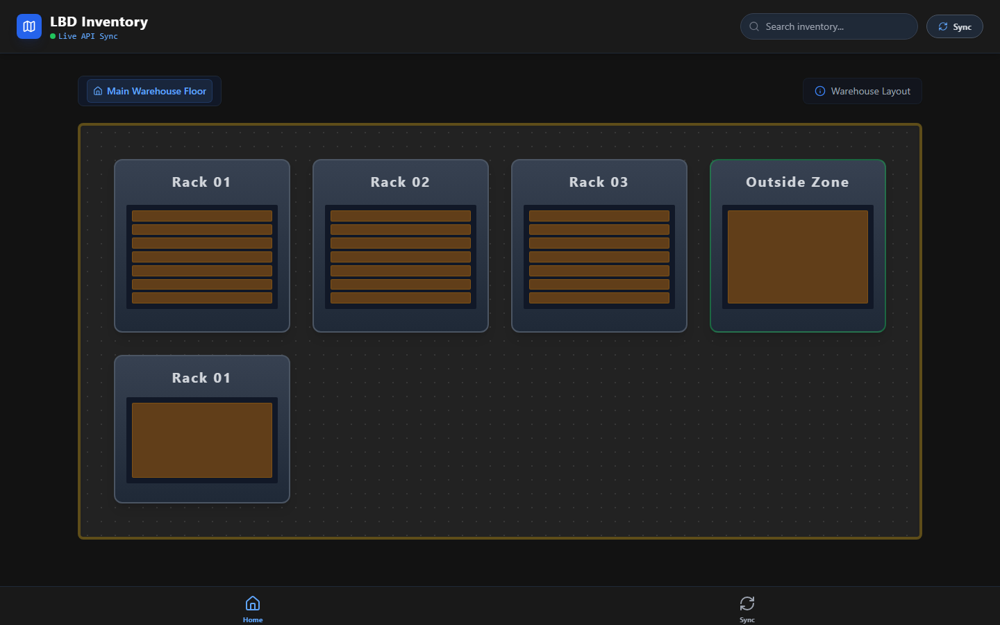

# Warehouse Visualizer (LBD Inventory)

**Live:** https://photographicode.github.io/Warehouse-Visualizer/

A visual inventory for an equipment warehouse. Instead of scrolling a spreadsheet, you click through racks, sections, pallets and flight cases to see exactly what is inside each one.

## Features

- **Drill-down view:** rack → section → pallet / flight case (top or bottom) → items
- **Google Sheets as the database** — reads the existing inventory sheet through a Google Apps Script API, so the team keeps using the sheet they already know
- **Add and edit from the app** — new sections, pallets, boxes and items are pushed back to the sheet
- **Optimistic updates** — the screen changes at once, then syncs in the background
- **Duplicate check** across the whole warehouse before adding an item code
- **Column-shift auto-correction** when the sheet layout changes
- **Status per item** (e.g. "Ready for Shipping") and notes

## Stack

Single-file HTML + Tailwind CSS + vanilla JavaScript, Google Sheets + Apps Script backend, GitHub Pages. Built with AI-assisted development (Claude).

## Run

Open `index.html` in a browser. Point the Apps Script URL in the configuration block at your own sheet's deployment.
